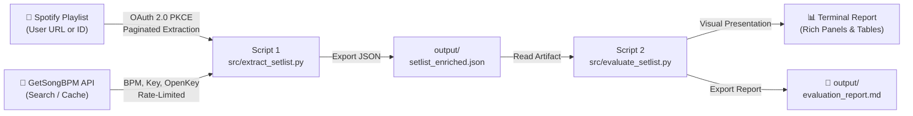

# 🎧 DJ Setlist Harmonic & Tempo Analyzer (MVP)

A command-line tool designed to evaluate the harmonic and tempo fluidity of a DJ setlist arranged directly within a Spotify playlist. 

The application reads tracks in their exact sequence, enriches them with musical metadata (BPM and Musical Key) via external APIs, assesses pairwise transitions across the **Camelot Wheel** and tempo variations, executes **logical counterproofs** (half/double-time detection and internal reordering suggestions), and generates visual reports in both the terminal and Markdown.

---

## 🏗️ Architecture & Data Flow

The project is decoupled into two independent execution phases connected by a structured JSON artifact (`output/setlist_enriched.json`), avoiding redundant external API calls during rule tuning.



---

## 📁 Project Structure

```text
spotify-reader/
├── .env.example                            # Template for environment variables
├── .gitignore                              # Protects secrets, cache, and build files
├── README.md                               # Project documentation & setup guide
├── requirements.txt                        # Python dependencies
├── docs/                                   # Documentation & specifications
│   ├── product_requirements_document_mvp.md
│   └── technical_specification_document_mvp.md
├── cache/                                  # Local cache storage (auto-generated)
│   └── getsongbpm_cache.json
├── output/                                 # Output artifacts (auto-generated)
│   ├── setlist_enriched.json
│   └── evaluation_report.md
└── src/
    ├── __init__.py
    ├── config.py                           # Configurations, thresholds, and dir creation
    ├── models.py                           # Pydantic v2 schemas and enums
    ├── camelot.py                          # 24-key Camelot wheel & harmonic rule engine
    ├── extract_setlist.py                  # Script 1: Spotify extraction & BPM enrichment
    └── evaluate_setlist.py                 # Script 2: Transition evaluation & counterproofs
```

---

## ⚙️ Core Modules & Implementation Details

| Module | Purpose | Key Features |
| :--- | :--- | :--- |
| `src/config.py` | Configuration management | Loads `.env`, exposes API credentials, defines tempo thresholds (`3.5%` comfortable, `6.0%` moderate, `4%` half/double tolerance), and creates output directories. |
| `src/models.py` | Data modeling & validation | Strongly typed Pydantic v2 models: `AudioFeatures`, `Track`, `Setlist`, `TransitionStatus`, and `TransitionDetail`. |
| `src/camelot.py` | Harmonic analysis | Complete mappings for all 24 Open Key (Traktor) codes and musical keys into Camelot codes (`1A`-`12B`). Implements circular distance and harmonic classification rules. |
| `src/extract_setlist.py` | Extraction & enrichment | Uses Spotipy with PKCE authentication, paginates through tracks, cleans remix/edit suffixes for better API matching, queries GetSongBPM with local JSON caching, and saves `setlist_enriched.json`. |
| `src/evaluate_setlist.py` | Transition engine & reports | Evaluates consecutive track pairs, verifies half/double time relations, searches for playlist tracks that would fit better, computes 4-segment energy curve, and generates terminal (Rich) and Markdown reports. |

---

## 🎼 Transition Scoring Matrix

| Criterion | Technical Rule | Status | Action / Meaning |
| :--- | :--- | :--- | :--- |
| **Harmonic Match** | Same Camelot code, adjacent `±1` (same mode), or relative major/minor | `IDEAL` ✅ | Smooth harmonic transition |
| **Energy Boost** | Leap of `+2` or `+7` on the same mode | `GOOD (BOOST)` 🔵 | Uplifting energy transition |
| **Harmonic Clash** | Any other step on the Camelot Wheel | `CRITICAL ALERT` 🔴 | Potential dissonance |
| **Comfortable Tempo** | Tempo delta `≤ 3.5%` | `IDEAL` ✅ | Transparent pitch adjustment |
| **Moderate Tempo** | Tempo delta between `3.5%` and `6.0%` | `WARNING` ⚠️ | Requires technical mix / echo-out |
| **Abrupt Tempo Shift**| Tempo delta `> 6.0%` | `CRITICAL ALERT` 🔴 | Rhythm break (triggers counterproof) |

### 🔍 Counterproof Engine
When a transition triggers a `CRITICAL ALERT`:
1. **Half-Time / Double-Time Check:** Verifies if $BPM_B \approx 2 \times BPM_A$ or $BPM_B \approx \frac{1}{2} BPM_A$ within $4\%$ tolerance. If valid, the alert is downgraded to `WARNING` with an informative note.
2. **Internal Reordering Suggestion:** Checks remaining tracks in the playlist to recommend tracks that would form an `IDEAL` or `GOOD (BOOST)` transition with both harmonic and tempo compatibility.

---

## 🚀 Getting Started Locally

### 1. Prerequisites
- **Python 3.11+** installed on your system.
- **Spotify Developer App**:
  - Create an app at the [Spotify Developer Dashboard](https://developer.spotify.com/dashboard).
  - Add `http://127.0.0.1:8888/callback` as a **Redirect URI** in your app settings.
  - Copy the **Client ID**.
- **GetSongBPM API Key**:
  - Request an API key at [GetSongBPM API](https://getsongbpm.com/api).
  - *Tip:* Provide your public repository link as the required backlink URL.

### 2. Installation & Setup

Clone the repository:
```bash
git clone https://github.com/FCappellari/spotify-reader.git
cd spotify-reader
```

Create and activate a virtual environment (optional but recommended):
```bash
python -m venv .venv
# On Windows (PowerShell):
.venv\Scripts\Activate.ps1
# On Linux / macOS:
source .venv/bin/activate
```

Install dependencies:
```bash
pip install -r requirements.txt
```

Configure your environment variables:
```bash
# Copy the example file
cp .env.example .env
```
Edit `.env` with your actual credentials:
```env
SPOTIPY_CLIENT_ID="your_spotify_client_id_here"
SPOTIPY_REDIRECT_URI="http://127.0.0.1:8888/callback"
GETSONGBPM_API_KEY="your_getsongbpm_api_key_here"
```

---

## 💻 Running the Application

### Phase 1: Extract & Enrich Setlist
Run **Script 1**, passing a Spotify playlist URL or ID:
```bash
python -m src.extract_setlist "https://open.spotify.com/playlist/37i9dQZF1DXcBWIGoYBM5M"
```
*(On first execution, Spotify will open your browser for OAuth authorization).*  
The enriched dataset will be saved to `output/setlist_enriched.json`.

### Phase 2: Evaluate Setlist Transitions
Run **Script 2** to analyze the exported dataset:
```bash
python -m src.evaluate_setlist
```
This generates:
- An interactive terminal summary with Rich tables, colors, and overall set score.
- A complete Markdown report written to `output/evaluation_report.md`.

---

## 📚 Acknowledgments & Data Attribution
* Musical metadata (BPM, Musical Key, and Open Key) provided by [GetSongBPM](https://getsongbpm.com).
